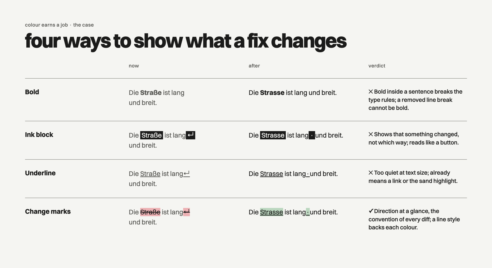
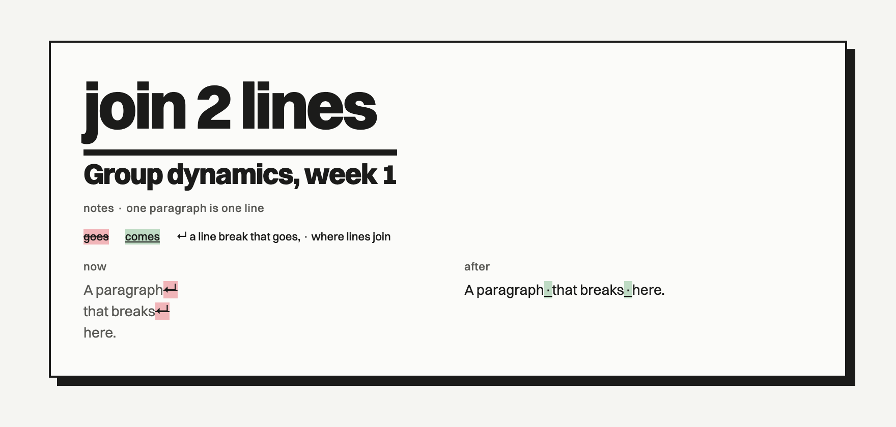

# JKD design guidelines

JKD is the design system of Johannes Klaus Design: **Swiss typography on a
brutalist base, in black and white**. Type is the image, the grid is visible,
edges are hard, and colour appears only when it has a job. One system serves
apps (macOS, iOS), web pages, slides and print.

## How to read this document

- **The tokens at the top of this file are the source of truth.** Every value
  below (a colour, a size, a gap) is defined there once. Code reads them from
  `swift/` (SwiftUI) and `web/jkd.css` (HTML); never type a value by hand.
- **Rule words.** **MUST** and **NEVER** are hard rules: breaking one is a
  defect. **SHOULD** is the default: depart from it only with a reason you can
  state. **MAY** is allowed, not required.
- **Units.** Sizes are in points (pt). On the web 1 pt = 1 CSS px.
- **Detail lives in `references/`**: typography, components, the expressive
  layer, words, accessibility, platforms, review. This file is complete on its
  own; the references add how and why.
- **Products are themes** (`themes/`). A theme MAY change a value or add one
  signature element; it MUST NOT rename a token or break a rule here.
- **Versions** are in `CHANGELOG.md`; this file states the rules as they are now.

## 1. The rules on one page

1. **The grid decides.** Every gap and position is a multiple of 4 pt.
2. **Type is the image.** One family (Switzer), the scale in section 3,
   hierarchy by size and weight. The top of the hierarchy is huge; everything
   else is quiet.
3. **Black and white until colour earns a job** (section 2.3).
4. **Sand is a hairline.** The accent #C9B69B is only ever a line of 3 pt or
   less. NEVER a fill, a button or text.
5. **Brutal, not rough.** Square corners, 2 pt ink edges, solid shadows offset
   8 pt with no blur, heavy 6 pt rules between sections.
6. **One bar per screen**, over the most important word.
7. **One primary action per view**, as an ink plate.
8. **At most one expressive moment per screen**, never on the path people use
   every day.
9. **Show, don't tell.** Numbers, symbols and piles before sentences.
10. **Accessible by construction.** Contrast computed, colour never alone,
    everything reachable by keyboard, every size scales.

## 2. Colour

### 2.1 The palette

Grouped by role. Light is the White theme, Dark the Black theme.

**Base**

| Token | White | Black | Use | Contrast |
| --- | --- | --- | --- | --- |
| `ink` | #1B1B1A | #ECECE8 | Text, the bar, plates, heavy rules | 15.8:1 / 15.3:1 on page |
| `page` | #F5F5F2 | #161615 | Layer 0, the background | |
| `raised` | #FBFBF9 | #1F1F1E | Layer 1: slabs, cards | ink 16.6:1 / 13.9:1 |
| `sunken` | #EAEAE6 | #111110 | Layer 1: wells, fields, chips | ink 14.3:1 / 16.0:1 |

**Text and lines**

| Token | White | Black | Use | Contrast |
| --- | --- | --- | --- | --- |
| `secondary` | #5A5A56 | #A0A09B | Quieter text, captions | 6.3:1 / 6.9:1 on page |
| `onInk` | #F5F5F2 | #161615 | Text on a plate or band | 15.8:1 |
| `rule` | #979892 | #555552 | Decorative hairlines only | 2.7:1 / 2.0:1 |
| `boundary` | = ink | = ink | An edge a person must see | as ink |
| `shadow` | = ink | = ink | The solid shadow under slabs and plates | |

**Accent, states and meaning**

| Token | Value | Use | Contrast |
| --- | --- | --- | --- |
| `accent` (sand) | #C9B69B | Thin lines only, 3 pt or less | 1.8:1 on page (decorative) |
| `hover`, `active` | ink at 6% / 12% (8% / 16% in Black) | Row and surface washes | |
| `status` | system red, orange, green | Errors, warnings, success, with a word | |
| `change` | red / green at 28% | What goes / what comes (2.4) | ink 8.6:1 or more |

Why not pure black and white: at poster sizes, #000 on #FFF glares and leaves an
afterimage. Soft ink on soft paper still reads as black and white, keeps
contrast near 16:1, and is easier on the eye for long sessions.

### 2.2 Rules

- Text MUST be `ink` or `secondary`. Both keep at least 4.5:1 on every layer.
- `rule` is decoration. An edge a person needs in order to use something (a
  field, a toggle track, a focus ring) MUST use `boundary` or a fill.
- Sand MUST stay a line of 3 pt or less (a hover line on a plate, a selection
  edge, the highlight under one word). NEVER a fill, a button or text.
- The primary action is an ink plate, never a coloured one.
- Status colours come from the platform so they follow Increase Contrast and
  dark mode. Each MUST carry a word or a symbol too.
- Data colours (a user's labels, a chart's series) belong to the content. They MAY appear wherever that content does, and
  NEVER on brand elements or controls.
- Layers: `page` is layer 0; `raised` and `sunken` are layer 1. NEVER nest a
  slab in a slab. Menus, popovers and sheets use the platform's material.

### 2.3 When colour earns a job

The default is black and white. A new colour is admitted only if it passes
**all four** questions:

1. **Does it carry information?** Taking it away would lose something a
   person needs, or force them to compare by eye what the screen could show.
   Mood and decoration do not count.
2. **Can black and white not do it as well?** Weight, size, an ink block, a
   rule, a symbol and position were tried first and are worse at this job.
3. **Is it never alone?** A second cue (a line style, a symbol, a word) says
   the same thing, so it works without colour vision and in greyscale print.
4. **Does it come from the platform or the content?** System colours that
   follow accessibility settings, or the data's own colours. Not a new brand
   colour.

Every admitted colour is recorded below with its case, so the next request is
judged against a precedent and not against taste.

### 2.4 Case: change marks (October 2026)

**Situation.** A review screen offers fixes to a set of notes, one card per
fix: joining lines that one paragraph was broken into, Swiss spelling (ss for
ß), a heading on its own line. Each card showed the text *now* and *after* in
two columns of black and grey type.

**Problem.** In the real window it was not clear what each card would do.
Measured against Nielsen's ten usability heuristics, two failed: *visibility of
system status* (the card did not show what the fix changes) and *recognition
rather than recall* (to see the change, a person had to read both columns and
compare them in their head). On a line-join card the only difference is a few
invisible line breaks; on a spelling card, one letter in a long sentence.

**What black and white could do.** Bold changed words: the after column is
already medium weight, and bold inside a sentence breaks the type rules. An ink
block with white text: it marks *that* something changed but not *which way*,
and an inverted word in running text reads as a button. An underline alone: too
quiet at 12 pt, and it already means a link or the sand highlight.

**Decision.** The designer chose to mark "what changes" and allowed colour for
it. Red for what goes and green for what comes is the convention of every diff,
track changes view and code review, so it reads without learning
(*match between system and the real world*). It passes the test: it carries
the change (1); black and white could not show direction as well (2); every
mark also has a line style, struck through or underlined, and a removed line
break shows as ↵ (3); the colours are the platform's red and green at a 28%
tint behind ink text, which keeps 8.6:1 or more (4).

**Rules that came with it.** Only on text that shows a change. The tint goes
behind the text; the text itself stays ink. A key ("goes", "comes") on every
surface that uses the marks. NEVER on a button, a status or decoration.
Component: section 6.

## 3. Typography

**Switzer** (Indian Type Foundry, Fontshare licence: free for commercial, app
and web use, credit the foundry), a neo-grotesk from Thin to Black. Apps bundle
it; pages load it from Fontshare. Fallback: Helvetica Neue, Helvetica, Arial.
**Space Mono** MAY be used for one job only: technical readouts.

### 3.1 The scale

| Step | Size | Weight | Tracking | Use |
| --- | --- | --- | --- | --- |
| caption | 11 | Medium, lowercase | +0.4 | Labels, counts, metadata |
| small | 13 | Regular | 0 | macOS body text |
| body | 17 | Regular | 0 | iOS and web body text |
| lead | 20 | Regular | 0 | An opening paragraph |
| title | 28 | Bold | -0.4 | Section titles |
| display | 36 | Bold | -0.8 | Large titles |
| headline | 64 | Black | -2.4 | The one number or name that matters |
| poster | 72 | Black | -2.9 | Narrow page titles, posters |
| monument | 108 | Black | -4.3 | Page titles in apps |
| giant | 160 | Black | -6.4 | Posters, empty states |

### 3.2 Rules

- Use only the scale. NEVER invent an in-between size.
- Text MUST be flush left, ragged right. NEVER justified; centre only a single
  line on a poster or an empty state.
- Black weight for headline and larger; Bold for titles; Regular for text;
  Medium for captions and labels. Light only at 16 pt and up. NEVER bold or
  italic inside a sentence.
- Captions and page titles are lowercase. Body text is sentence case. Buttons
  and menus follow the platform (title case on a Mac).
- Display sizes: leading 0.9. Text: leading 1.35. Reading lines 45 to 75
  characters.
- Numbers that change or line up MUST be tabular.
- One screen SHOULD use two or three sizes, with big jumps between them.
- Sizes MUST scale (Dynamic Type on iOS); layouts reflow instead of truncating.

## 4. Layout

- **Unit 4 pt; the cube is 8 pt** (two units). Every gap comes from the
  spacing steps: 4, 8, 12, 16, 24, 32, 48, 64, 96.
- **Columns**: 4 on a phone, 12 on a Mac window, a web page and print. Content
  aligns to column edges; images bleed to an edge or sit on a column.
- **Margins**: 16 on iPhone (the system list inset), 32 in a Mac content pane;
  in print 20 mm at the top and sides and a 25 mm chin at the bottom.
- **Asymmetry is the default.** Weight to the left and the top; leave whole
  columns empty rather than filling to the edge.
- **Nothing important below a long list.** Actions go above it or in the
  toolbar.
- **Many of the same is a pile** (section 6): three or more identical things are
  drawn once with a count.
- Pages MUST work at 320 pt wide without horizontal scrolling. Side-by-side
  layouts stack when they no longer fit.

## 5. Shape and depth

- **Corners are square** (0) on everything the brand draws: the bar, rules,
  images, slabs, plates, fields, chips. Round only where the shape means
  something: a count badge, an avatar. Platform controls keep their own shapes.
- **Mostly flat.** Things sit on the page.
- **Slab**: the one or two things on a screen that a person acts on. Raised
  fill, 2 pt ink edge, solid shadow offset 8 pt with no blur.
- **Plate**: the primary action. Ink fill, onInk text, the same solid shadow;
  pressed, it sinks into the shadow.
- In dark mode the shadow is white.

## 6. Components

Implemented in `swift/Sources/JKDDesign` and `web/jkd.css`; details in
`references/components.md`. Platform controls (lists, menus, toolbars, text
fields) stay platform controls; these are the brand pieces around them.

| Component | What it is | Use it for | Never |
| --- | --- | --- | --- |
| **Bar** | A heavy square ink rule over a word, as wide as the word, hugging it: about 1/6 of the type size thick, 1/12 away | The single most important name on a screen; also the progress bar | More than one per screen; rounded ends |
| **Page title** | Lowercase monument (108) under its bar | The page's name | Sentence case; two per page |
| **Band** | A full-width inverted section | The loudest thing on a screen, at most two | A list; text to study |
| **Heavy rule** | A 6 pt ink rule across the column | Between sections | Between rows |
| **Section index** | The section's number (01, 02) in an ink square | Pages a person goes through in order | A lone section |
| **Slab** | Raised, 2 pt ink edge, solid 8 pt shadow | What you act on: a card, a proposal | Every row; a slab in a slab |
| **Plate button** | Ink fill, white words, solid shadow | The one primary action per view | Two per view; colour |
| **Quiet button** | Words only, underlined on hover | Secondary actions | A box around it |
| **Chip** | A square choice button with a checkmark when on | Choices, especially in iOS sheets | Colour as the only on/off cue |
| **Caption** | 11 pt lowercase label | Labels, counts ("filed 4 · trash 1") | Dashes; sentences |
| **Highlight** | A 3 pt sand underline | The one word that matters | Fills; more than one per screen |
| **Switch** | White or black, both words visible | The page theme | An icon alone |
| **Pile** | One item with two offset copies and a count | Three or more identical things | Two items; different items |
| **Change marks** | Red tint and struck through (goes), green tint and underlined (comes), ink text, a key | Showing what a change removes and adds | Buttons, status, decoration |
| **Numbers** | Tabular figures; unknown shows — | Counts, money, anything that changes | A made-up value |

## 7. Expressive layer

Halftone, paper grain, liquid chrome, ordered dither and blob tracking, from the
studio's print and TouchDesigner work. Details in `references/expressive.md`.

- At most **one** per screen or page.
- Each effect has its own jobs:

| Effect | Use it for | Example | Never |
| --- | --- | --- | --- |
| **Halftone** | Turning a picture or a tone into the brand's one ink; a hover reveal of the original | Project thumbnails, a cover photo, a poster image | Text that must be read sits on it |
| **Grain** | Making a surface feel printed | A cover slide, a poster, a printed page's background | Behind body text on screen |
| **Chrome** | One celebratory word or mark | "all sorted", a finished milestone, an app icon, a title on a cover | Anything someone reads twice a day |
| **Dither** | Something being worked on: loading, dealing, rendering | A deck being shuffled, an image preparing | Static decoration |
| **Blob tracking** | Showing that the system sees or detects | First run, a scan, a camera or detection view | Lists, forms, settings |
| **Reacting type** (moiré, slit-scan, misregistration) | A section opener or an Easter egg that rewards play | A portfolio section title | Navigation, labels |

- MAY appear on an empty state, onboarding, a celebration, an app icon, a
  poster, a cover slide, a section opener or an Easter egg.
- NEVER on the frequent path, behind body text, on a control, or as the only
  carrier of meaning.
- MUST switch off with Reduce Transparency or Increase Contrast, MUST stop with
  Reduce Motion, and MUST be hidden from VoiceOver.

## 8. Words

Details in `references/voice.md`.

- Concise and plain. If a word can go, it goes. Captions are fragments.
- NEVER a dash as punctuation: use a colon, a comma, a full stop or a middle dot.
- Numbers over sentences ("3 of 4").
- One name per action: the button says "File", the result says "Filed".
- Errors say what happened and what to do next. Confirmations name exactly what
  will happen, with the count.
- Plain words for machinery: "memory", not "embeddings".

## 9. Accessibility

Accessibility findings outrank every style finding. Details in
`references/accessibility.md`.

- Text 4.5:1 or more; large text, meaningful icons and needed edges 3:1. Every
  token pair is tested by `swift test` in `swift/`; a new pair gets a test first.
- Colour NEVER alone: a word, a symbol or a shape says the same.
- Dynamic Type, Reduce Motion, Reduce Transparency, Increase Contrast and dark
  mode MUST work.
- Mac: every command in the menu bar, everything works from the keyboard,
  focus is visible. iOS: targets 44 × 44 pt.
- VoiceOver: headers marked, decoration hidden, custom controls labelled.

## 10. Platforms and adaptation

Details in `references/platforms.md`.

- **macOS**: system sidebar, toolbar and menus; content margins 32; body 13.
- **iOS**: body 17 with Dynamic Type; margin 16; controls in real toolbars.
- **Web**: load `web/jkd.css` and Switzer from Fontshare; respect the reduced
  motion, contrast and transparency settings.
- **Print and slides**: 20 mm top and sides, a 25 mm chin; 12 columns; one
  idea per slide; fonts embedded.
- Without Switzer: Helvetica Neue, then Helvetica, then Arial. NEVER a
  geometric or humanist face.
- A dense tool MAY halve the spacing steps it uses; it keeps the 4 pt unit.

## 11. Glossary

- **The bar**: the system's mark, a heavy square rule laid over a word.
- **Band**: a full-width section in inverted colours.
- **Cube (b²)**: the 8 pt reference square; placements are whole cubes.
- **Expressive layer**: the optional effects in section 7.
- **Heavy rule**: a 6 pt ink line between sections.
- **Pile**: many identical things shown as one with a count.
- **Plate**: an ink-filled button with a solid shadow; the primary action.
- **Sand**: the accent colour #C9B69B, used only as a thin line.
- **Slab**: a raised card with an ink edge and a solid shadow; what you act on.
- **Theme**: a product's adaptation of JKD (`themes/`).

## 12. Review checklist

Answer each with yes or no; every "no" is a finding. Accessibility first.

1. Does every text pair reach 4.5:1 (large text 3:1)?
2. Is every colour backed by a word, symbol or shape?
3. Do Dynamic Type, Reduce Motion and Increase Contrast work, and does the
   layout fit at 320 pt?
4. Is every command reachable by keyboard (and in the menu bar on a Mac)?
5. Is every gap a multiple of 4?
6. Are all sizes from the scale, flush left, with tabular numbers?
7. Is there at most one bar, one plate and one expressive moment?
8. Is every colour beyond black, white and sand admitted by section 2.3?
9. Are corners square and shadows solid?
10. Are the words free of dashes, with one name per action?
11. Covered with the logo, would the screen still be recognisably JKD?

For the reporting format, see `references/review.md`.
