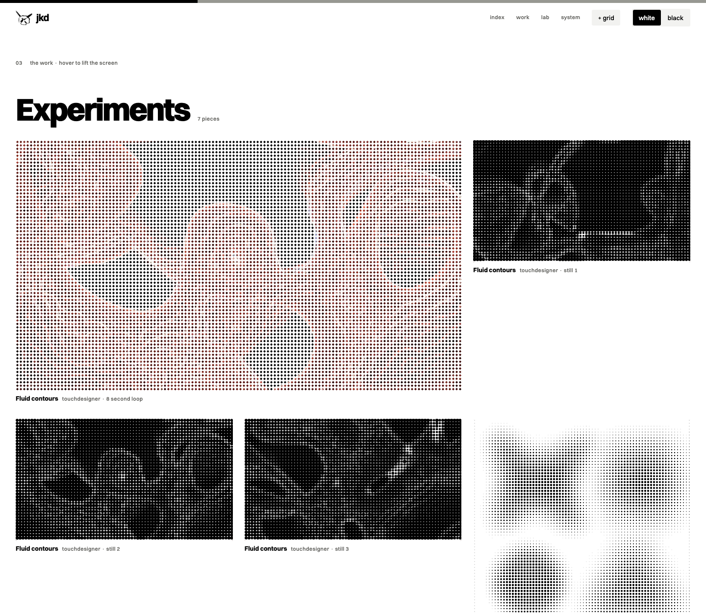

<picture>
  <source media="(prefers-color-scheme: dark)" srcset="assets/site-hero-dark.png">
  
</picture>

# JKD design

**Swiss typography on a brutalist base, black and white. The design system of Johannes Klaus Design.**

The house style of Johannes Klaus Design: **Swiss typography on a brutalist
base** (from the büro brand guide), set in **Switzer**, black and white, with an
occasional halftone, dither, liquid chrome or blob tracking moment. One system for his apps (macOS,
iOS), web pages and print, packaged as a Claude Code skill.

**Contents:** [At a glance](#at-a-glance) · [The showcase site](#the-showcase-site) ·
[In an app](#in-an-app) · [Quick start](#quick-start) · [Install as a skill](#install-as-a-skill) ·
[Use in an app](#use-in-an-app) · [Change the style](#change-the-style) ·
[Repository layout](#repository-layout) · [Versions](#versions) · [Licence](#licence) · [Contact](#contact)

## At a glance

1. **The grid decides.** Unit 4, the büro reference cube 8, 4 columns on a phone and 12 everywhere else.
2. **Type is the image, at poster scale.** One family, Switzer, in nine sizes, flush left. Page titles at 108 pt Black, the name that matters at 64, the bar hugging the word (0.6).
3. **Black and white, with sand as a hairline.** The büro sand (#C9B69B) appears only as thin lines of 3 pt or less, never as a button or a fill. Every text pair is tested for contrast.
4. **Raw, not rough.** Hard edges, hard shadows, a 3 point corner, and the bar over the most important word.
5. **One loud moment per screen.** Halftone, grain, liquid chrome, dither, blob tracking and type that reacts, never on the path you take daily.

## The showcase site

A portfolio in the making, built from the system and nothing else. White by
default with a white or black switch; the bar at the top is the scroll
progress; **G** shows the 12 column grid; the brush mark is set in halftone
and swells around the pointer.

| | |
| --- | --- |
|  |  |

### The work

His projects in chapters on the grid. Every piece wears a halftone screen
until you hover, focus or tap it; then the screen lifts and the original
shows.

| | |
| --- | --- |
|  |  |
|  |  |
|  | |

### Lab: type that reacts

Five real processes, and not one letter changes size. Each settles into plain,
readable type when nothing moves.

| | |
| --- | --- |
|  **Blob tracking**, the TouchDesigner look. The detection is real: a connected component pass on the pixels, every frame. |  **Moiré**, after Wolfgang Weingart. The word exists only as a shift between two dot screens. |
|  **Slit-scan**. Each band is a moment behind the one above; scroll fast and it smears. |  **Misregistration**. Speed pulls the halftone plate off register; a spring brings it home. |
|  **The composing stick**. Sorts arrive mirrored, quads in grey; then the proof reads. |  Blob tracking is an inverted section: black on the white page, white on the black one. |

| | |
| --- | --- |
|  |  |

Run it: from the repository folder, `python3 -m http.server 8765`, then open
`http://127.0.0.1:8765/examples/site/`. Opening `examples/site/index.html` directly
works too. `?shot=blob` (or `hero`, `work`, `showcase`, `moire`, `slit`,
`misreg`, `stick`, `system`, `footer`) freezes the state used for these images;
add `&theme=dark` for black, `&chapter=posters` and `&open=1` for the work.

## In an app

Card Sort from Auto-Sort, rebuilt with `JKDDesign` alone and rendered by
`examples/swiftui` (`swift run render`):

<picture>
  <source media="(prefers-color-scheme: dark)" srcset="assets/ui-cardsort-dark.png">
  
</picture>

<picture>
  <source media="(prefers-color-scheme: dark)" srcset="assets/ui-specimen-dark.png">
  
</picture>

## Quick start

| To | Do |
| --- | --- |
| See the site | `open examples/site/index.html` |
| Follow the style in Claude Code | link the skill (below), then ask for anything "in the JKD style" |
| Use it in a SwiftUI app | add `swift/` as a local package, `import JKDDesign` |
| Use it on a web page | link `web/jkd.css` and load Switzer from Fontshare |
| Check the tokens | `cd swift && swift test` |

**Requirements:** macOS 14 or iOS 17 and Swift 6 for the package; any current
browser for the site (Safari, Chrome, Firefox); Switzer installed or bundled
for apps, loaded from Fontshare for pages.

## Install as a skill

```
ln -s ~/Developer/jkd-design ~/.claude/skills/jkd-design
```

Then any Claude Code session can use it; a project's CLAUDE.md can say
"Follow the jkd-design skill" to make it the default.

## Use in an app

Xcode: File, Add Package Dependencies, Add Local, pick `swift/`. Then
`import JKDDesign`. Bundle the Switzer files in the app; without them the
package falls back to Helvetica Neue.

## Change the style

Edit `DESIGN.md`, `swift/Sources/JKDDesign/Tokens.swift` and `web/jkd.css`
together, run `swift test` in `swift/` (contrast of every text pair), retake
the images, and add a line to `CHANGELOG.md`.

## Credits and sources

Switzer by Indian Type Foundry (Fontshare licence). Space Mono by Colophon
Foundry (Open Font License), for readouts only. The büro Brand Development
Guide and the brush mark are his own. The Swiss International Typographic
Style, Wolfgang Weingart's work in Basel, Augury's interface rules, and the
apple-design skill's review lenses shaped the rest. Two confidential design
documents he has access to were read for structure only; nothing from them is
in this repository, and nothing may be added.

## Repository layout

```
DESIGN.md            the spec: tokens, then rules
SKILL.md             the Claude Code skill
references/          typography, components, expressive layer, voice, accessibility, platforms, review
themes/              Auto-Sort, Augury
swift/               JKDDesign package and its contrast tests
web/jkd.css          tokens and components for HTML
examples/site/       the showcase site (index.html, site.js, assets/)
examples/swiftui/    renders the app images (swift run render)
assets/              the screenshots in this README
CHANGELOG.md         what changed, version by version
LICENSE              all rights reserved, and the font licences
```

## Versions

Current: **0.5**. See [`CHANGELOG.md`](CHANGELOG.md). 0.5 made the style louder
(poster titles, a 48 pt headline, the heavy bar, one inverted band per screen),
chose büro sand as the accent, only ever as a thin line, and added a rendered
liquid chrome texture, ordered dither and a blob tracking view to the SwiftUI
package. The primary button stays an ink plate.

## Licence

All rights reserved; see [`LICENSE`](LICENSE). The project work shown belongs to
Johannes Klaus and, where it was made for them, to the respective clients.
Switzer and Space Mono are not stored here: pages load them from Fontshare and
Google Fonts under their own licences.

## Contact

Johannes Klaus Design · Instagram [@jonny.klaus](https://www.instagram.com/jonny.klaus/)
